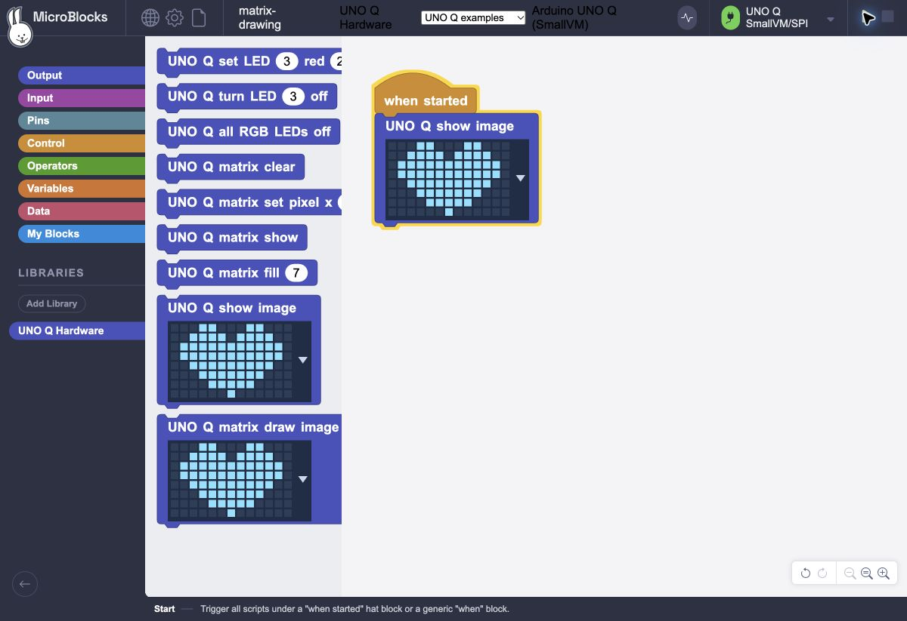

# MicroBlocks on Arduino UNO Q

Run the real MicroBlocks browser IDE locally on Arduino UNO Q, with SmallVM
executing programs on its STM32U585. An Arduino App Lab Python Custom Brick
serves the editor and carries binary WebSocket traffic through Arduino Bridge.

This community port extends an existing, physically tested UNO Q implementation.
MicroBlocks and its GP editor remain upstream projects; see [licensing](LICENSING.md)
and [pinned source revisions](SOURCE_REVISIONS.md).



## Start here

Read [START_HERE.md](START_HERE.md) for installation and use. The importable App
is [dist/microblocks-uno-q-app.zip](dist/microblocks-uno-q-app.zip); a complete
community ZIP is available under this repository's Releases. The editor opens
directly on port 8080, without an access token, password or login.

The MCU runtime is installed separately using the guarded procedure in
[RECOVERY.md](RECOVERY.md). Normal App start, stop, restart and browser reconnect
do not install firmware or reset the MCU. Programs currently live in RAM.

The installer requires the verified ArduinoCore-Zephyr 1.0.0 loader and refuses
other loader hashes. It backs up the complete application region and verifies
the loader before and after an explicit application update.

## What works

- Official MicroBlocks 2.5.8 editor/compiler with locally served assets.
- Physical STM32 SmallVM v417 bytecode upload, execution and reconnection.
- RGB LEDs 1/2 through a bounded Linux service queue; LEDs 3/4 directly on MCU.
- Native 13×8 LED matrix primitives, clickable image blocks and preset pictures.
- One browser controller with direct access, binary framing and bounded buffers.
- Existing PacoBlaze/SPI service preserved in the combined runtime profile.

| Evidence | Result |
|---|---|
| Browser arithmetic | Physical MCU returned `12` for `5 + 7` |
| Output streaming | Exactly 500 values in order; no task/record CRC errors |
| Concurrent FPGA SPI | 100 successful PING/echo checks; zero FPGA flash writes |
| Visible hardware | Owner confirmed heart/checkerboard and sequential red/green/blue LEDs |
| App lifecycle | Import/start/restart and webview verified; MCU uptime preserved |
| Interpreter host tests | 35 executable wasm32 runs; simulated services/drivers |
| Graphical matrix input | 300 real GP assertions; all six presets and custom drawing match physical MCU readback |
| Direct browser access | HTTP 200 without credentials/cookies; live MCU connection verified |
| Binary server tests | 1,000 randomized round trips; simulated echo adapter |

See [TEST_RESULTS.md](TEST_RESULTS.md) for measured timing, corrected failures and
acceptance boundaries. Exact matrix orientation and optical grayscale were not
measured. The generic runtime is compiled but has not been deployed on a fresh
board; the physically tested combined profile retains the existing FPGA service.
This milestone covers onboard LEDs/matrix, not complete GPIO/sensor support.

## Build and test

Follow [BUILD.md](BUILD.md) for the exact installed toolchain and commands. These
commands compile and run host tests without flashing:

```sh
python3 tools/test_host_vm.py
python3 tools/test_matrix_slot.py
python3 tests/test_transport.py
python3 tests/test_installer_guards.py
python3 -m venv .venv
.venv/bin/pip install -r tests/requirements.txt
.venv/bin/python tests/test_server.py
```

The source snapshots, adapters, patches and dependency revisions accompany the
generated assets. [SHA256SUMS](SHA256SUMS) covers publication files;
[BUNDLE_VERIFICATION.json](BUNDLE_VERIFICATION.json) records the bundle audit.

## Repository contents

| Directory | Contents |
|---|---|
| `app/` | Python App Lab application and reusable `microblocks_bridge` Brick |
| `firmware/` | SmallVM adapter, build preparation and preserved SPI sketch |
| `runtime/` | Generic and combined LLEXT application images and manifests |
| `sources/`, `patches/` | Pinned upstream source subsets, libraries and modifications |
| `examples/` | Editable MicroBlocks library and arithmetic/output/RGB/matrix projects |
| `tools/`, `tests/` | Build, guarded installation, observation and host tests |
| `evidence/` | Sanitized compiler logs, test results, hashes and screenshots |
| `dist/` | Importable App Lab ZIP |

Private credentials, board addresses, recovery dumps and previous phase archives
are excluded. Serve the programming interface only on a private network or an
encrypted SSH tunnel, as described in [SECURITY.md](SECURITY.md).
